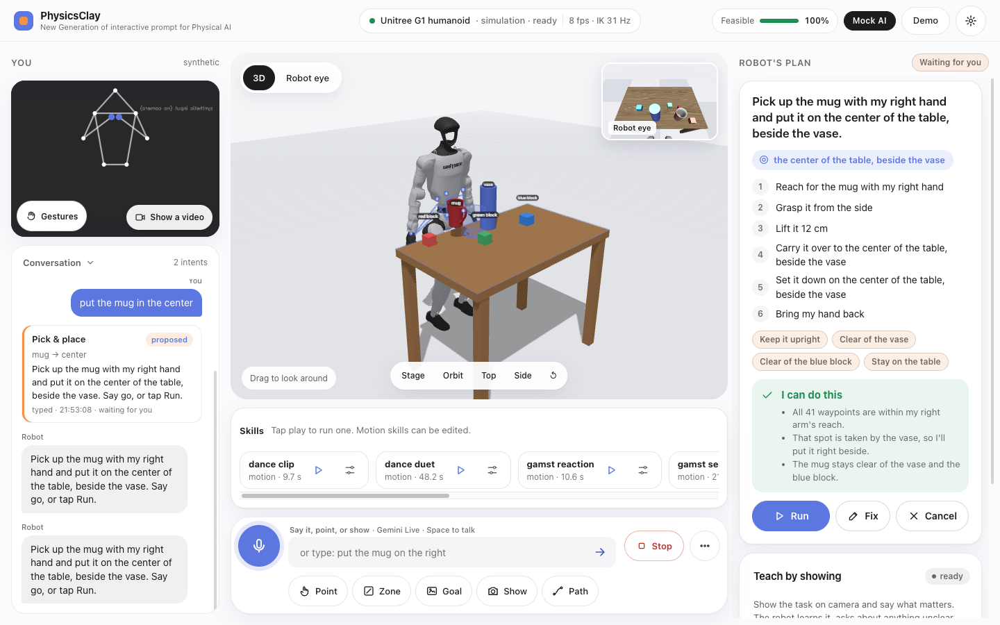
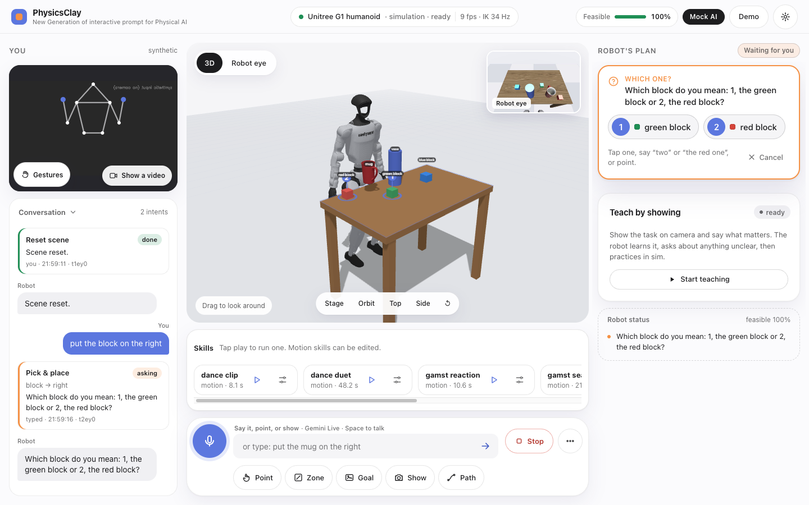
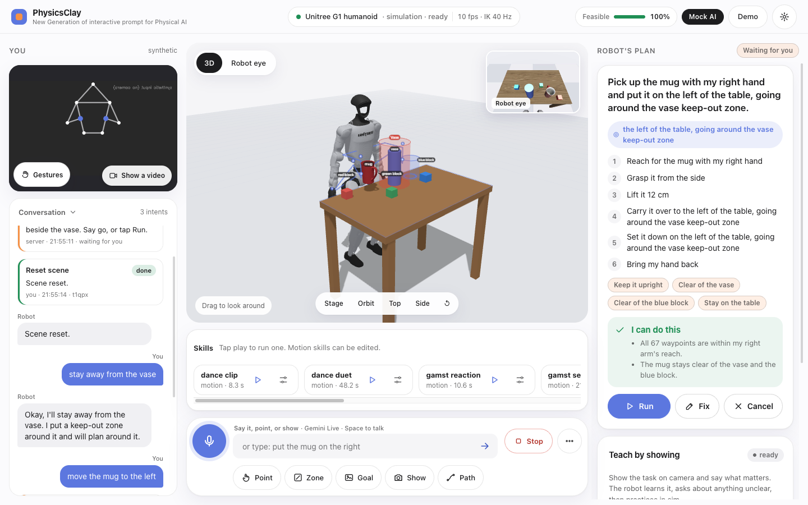
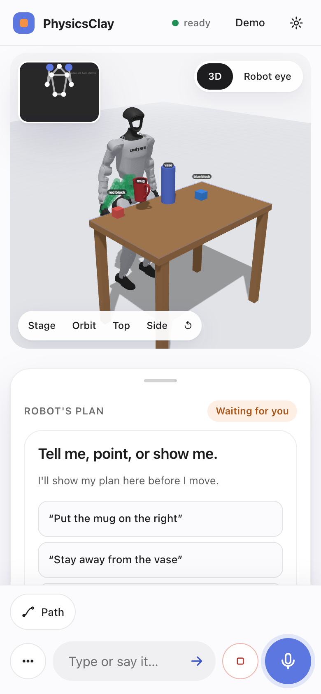
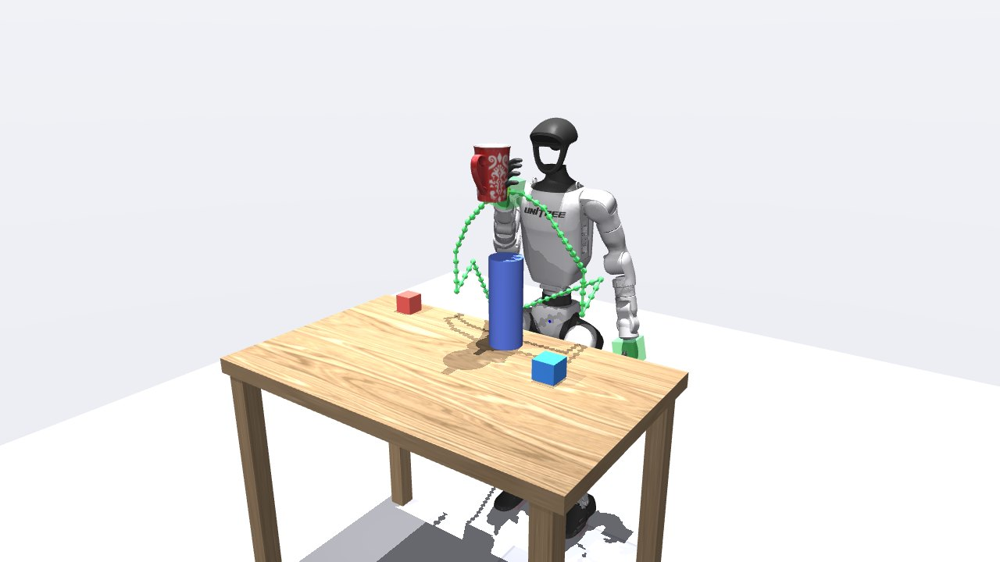
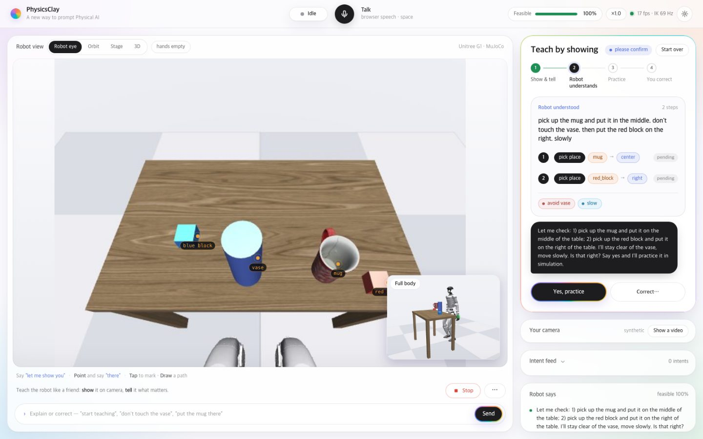

# PhysicsClay

**사람에게 일을 시키듯 로봇에게 일을 시킵니다. 말하고, 가리키고, 보여 주고, 그려서.
로봇은 사람을 보고, 계획을 제안하고, 실제 물리 안에서 움직입니다.**

[English](README.md) · 한국어 · [문서](docs/README.md) · [변경 기록](CHANGELOG.md)

PhysicsClay는 시뮬레이션 로봇에게 작업을 지시하는 오픈소스 웹 앱입니다. 말로 하거나, 테이블을 가리키거나, 카메라
앞에서 동작을 보여 주거나, 3D(또는 VR)에서 경로를 그리면 됩니다. PhysicsClay는 그 의도를 선택한 로봇 몸에 맞는
구체적인 계획으로 바꾸고, 모든 경유점을 MuJoCo 모델로 검사한 뒤, 계획과 동작의 고스트를 먼저 보여 줍니다. 그리고
"go"라고 해야만 실행합니다. 브라우저와 파이썬 서버(MuJoCo + [mink](https://github.com/kevinzakka/mink) + aiohttp +
three.js)로 내 컴퓨터에서 돌아가고, API 키 없이도 동작하며, 영어와 한국어를 모두 씁니다.

핵심 아이디어:

* **말하기 · 가리키기 · 보여 주기.** 말은 *무엇을*, *왜*를 전하고, 가리키기는 *어디*를, 시연은 *어떻게*를
  전합니다. "정확히 저기, 꽃병을 돌아서, 천천히"는 글만으로는 전하기 어렵고, 아예 말로 설명할 수 없는 동작도 있습니다.
* **로봇이 제안하고, 사람은 고칩니다.** 계획을 보기 전에는 아무것도 움직이지 않습니다. 틀린 곳이 있으면 그 부분만
  고치면 됩니다. 새 위치를 가리키거나, 경유점을 끌어 옮기거나, "거기 더 높게"라고 말하면 됩니다. 로봇이 할 수 없는
  일이면 이유("13 cm 너무 낮음")와 할 수 있는 가장 가까운 대안을 알려 줍니다.
* **실제 물리.** 로봇은 2 ms 간격의 동역학으로 시뮬레이션됩니다. 집기는 접촉으로만 버티고, 물체에는 질량과 마찰이
  있으며, 미끄러지거나 너무 무거우면 솔직하게 실패합니다. 물체를 손으로 순간 이동시키지 않습니다.
* **사람을 봅니다.** 사람의 몸, 손, 손에 든 도구가 로봇의 세계 안에 들어옵니다. 로봇은 사람을 따라 하거나(mirror),
  시연을 배우거나(learn), 미리 정한 규칙을 따르거나("손 내밀면 렌치 줘"), 도와주거나(assist), 코칭(coach)할 수
  있고, 사람 곁에서는 느려지고 멈춥니다.
* **로봇 학습을 위한 데이터 엔진.** 모든 작업을 LeRobot 데이터셋 에피소드로 녹화할 수 있고, 의도 하나를 여러 로봇,
  방, 물리 파라미터에 걸친 무작위 에피소드 여러 개로 다시 만들 수 있습니다.

## 스크린샷

이전 빌드(UX 2.0과 해커톤) 화면입니다. 지금도 배치는 같습니다.

| 로봇의 제안: 계획 카드 + 고스트 | 말이 여러 물체에 맞을 때: "어느 거요?" |
|---|---|
|  |  |
| **금지 구역: "꽃병 근처에 가지 마"** | **휴대폰 화면** |
|  |  |
| **3D로 그린 경로로 머그를 꽃병 너머로 옮기기** | **보여 주며 가르치기: 로봇이 이해한 내용을 되읽어 줌** |
|  |  |

이 README에 아직 필요한 화면(기여 환영, 직접 찍은 영상만): Panda의 물리 기반 집어서 놓기, 생성된 주방에서 서랍 열기,
gym 팩의 Watch → Coach, Quest에서 허공에 경로 그리기, 사진으로 만든 집을 수 있는 물체, 한국어 UI.

## 빠른 시작 (1분)

macOS 또는 Linux와 [uv](https://docs.astral.sh/uv/), git, curl이 필요합니다. 데이터셋 녹화에는 `ffmpeg`도
필요합니다.

```bash
git clone https://github.com/NomaDamas/PhysicsClay && cd PhysicsClay
make setup        # = ./scripts/setup.sh: .venv, 파이썬 의존성, 로봇 모델, MediaPipe 모델
make run          # 이 컴퓨터는 http://127.0.0.1:8780, 휴대폰·Quest는 https://<LAN IP>:8781
```

Chrome, Edge, Safari에서 **http://127.0.0.1:8780**을 열고 "머그를 오른쪽에 놓아줘"라고 입력한 뒤 계획 카드의
**Run**을 누르세요. 상단 바의 **?** 를 누르면 앱 안의 가이드가 열립니다.

* **키는 없어도 됩니다.** 키가 없으면 오프라인 규칙 파서(영어·한국어)와 브라우저 음성 인식이 명령을 받고,
  `make run ARGS="--mock"`을 쓰면 각본으로 움직이는 오프라인 두뇌가 붙습니다. Gemini Live(음성 + 비전)를 쓰려면
  **Settings → AI**에 Gemini 키를 넣으세요(이 브라우저에만 저장). 서버 키는 `.env`에 넣습니다(커밋되지 않음):
  `GEMINI_API_KEY`, `OPENAI_API_KEY`(로봇 목소리), 그리고 LLM 에이전트용 `LLM_BASE_URL`, `LLM_API_KEY`, `LLM_MODEL`
  (OpenAI 호환 Responses API면 무엇이든). `--byok` 서버에서는 방문자가 Settings에 자기 키를 넣습니다.
* **휴대폰과 Quest.** 휴대폰은 https에서만 카메라와 마이크를 내주기 때문에, `make run`은 자체 서명 인증서(처음
  실행할 때 `certs/`에 생성)로 8781 포트에서 https도 함께 엽니다. 경고는 한 번만 수락하면 됩니다. 터미널에 휴대폰
  주소(`https://<LAN IP>:8781/phone`)가 출력되고, 앱의 **Use my phone**을 누르면 QR 코드로 나옵니다.
* **옵션.** `make run HTTPS=0`(http만), `make run PORT=9000 HTTPS_PORT=9001`, `ARGS="--webcam"`(서버가 이 컴퓨터의
  카메라 사용), `ARGS="--kinematic"`(물리 끄기), `ARGS="--byok"`(공개 서버: 방문자가 자기 키를 씀,
  [SECURITY.md](SECURITY.md)).

전체 사용 가이드: [docs/USAGE.ko.md](docs/USAGE.ko.md) ([English](docs/USAGE.md)).

## 기능 둘러보기

### 로봇

[MuJoCo Menagerie](https://github.com/google-deepmind/mujoco_menagerie)(mink 예제를 통해)와 Unitree의 로봇 11종을
씁니다. 상단 바의 로봇 pill에서 바꾸거나 에이전트에게 부탁하면 됩니다. 같은 의도가 몸마다 따로 컴파일됩니다.

| 로봇 | 종류 | 그리퍼(물리) | 접촉 기반 집어서 놓기, 머그 · 블록(각 10회) | 상태 |
|---|---|---|---|---|
| Unitree G1 | 휴머노이드 | 손바닥 2패드 그리퍼(추가 제작, 15 cm) | 10/10 · 10/10 | 정상 |
| Franka Emika Panda | 팔 | 자체 손가락 | 10/10 · 10/10 | 정상 |
| Universal Robots UR5e | 팔 | 평행 조(추가 제작, 14 cm) | 10/10 · 10/10 | 정상 |
| uFactory xArm7 | 팔 | 자체 그리퍼 | 10/10 · 10/10 | 정상 |
| KUKA LBR iiwa 14 | 팔 | 평행 조(추가 제작, 14 cm) | 10/10 · 10/10 | 정상 |
| ALOHA | 양팔 | 자체 손가락, 팔 사이 건네주기 | 10/10 · 9/10 | 정상 |
| Apptronik Apollo | 휴머노이드 | 손바닥 2패드 그리퍼(추가 제작) | 10/10 · 10/10 | 정상 |
| Hello Robot Stretch 3 | 모바일 매니퓰레이터 | 스프링 평행 패드 | 10/10 · 10/10 | 정상 |
| Stanford TidyBot | 모바일 매니퓰레이터 | 자체 Robotiq 2F-85 | 10/10 · 10/10 | 정상 |
| Boston Dynamics Spot | 4족 + 팔 | 자체 집게 | 10/10 · 10/10 | 정상 |
| Unitree H2 | 휴머노이드 | 손 구동 안 함 | 집기 불가 | 실험적(뻗기, 경로) |

숫자는 `scripts/bench_grasp.py -n 10`(seed 0) 결과입니다. 측정 방법과 이력은 [docs/V1.md](docs/V1.md)에 있습니다.
휴머노이드와 Spot은 계획된 몸통 위치를 따라가는 하네스에 고정되어 서 있습니다. 걷기와 동적 균형은 없습니다.
모바일 베이스는 주행하지만 바퀴는 추상화되어 있습니다. `PC_PHYSICS=0`(또는 `--kinematic`)은 예전 kinematic
모드입니다. IK가 로봇 자세를 정하고, 집은 물체는 손에 붙어서 따라갑니다.

### 월드

나무 테이블, 주방 조리대, 선반, 바닥 매트, 체육관 바닥에 더해 **자동 생성되는 방**이 있습니다. 집 4종(주방, 식당,
거실, 세탁실)과 산업 현장 6종(컨베이어가 도는 조립 라인, 물류 창고, CNC 머신 텐딩, 전자 작업대, 실험실, 포장대)입니다.
seed마다 배치가 다르고, 서랍과 문은 실제 관절에 달려 있어 로봇이 손잡이를 잡고 엽니다. "위 서랍에서 숟가락 꺼내서
싱크대에 넣어줘" 같은 여러 단계 요청은 계획 카드 하나가 됩니다. 가이드: [docs/worlds.md](docs/worlds.md).

### 실제 사진 → 시뮬레이션 물체와 공간

물체 하나를 찍으면 실제 크기, 질량, 마찰을 가진, 로봇이 집을 수 있는 물리 물체가 됩니다. 내 테이블을 찍으면 같은
배치로 장면이 다시 만들어집니다. 오프라인에서는 단순한 형상으로 동작하고, 선택 모델이나 키가 있으면 깊이, 인식,
메시가 더 좋아집니다. 가이드: [docs/RECON.md](docs/RECON.md).

### 사람 보기 (Watch)

카메라(노트북, 휴대폰, Quest)가 켜져 있으면 로봇이 내 몸, 손, 손에 든 도구를 추적하고 내가 하는 일(활동, 단계,
반복 횟수)을 읽습니다. 모드: **mirror**(실시간으로 따라 하기), **learn**(시연을 녹화해 다시 하기), **respond**(미리
정한 규칙), **assist**(내가 힘이 빠질 때 힘을 제한해 돕기), **coach**(반복 횟수를 세고 회마다 한 마디). 자세한 내용은
[Watch 모드](docs/USAGE.ko.md#watch-모드).

### 궤적과 VR

경로는 완전한 3D 궤적입니다. 점마다 높이, 손목 방향, 속도, 힘, 그립, 허용 오차가 있고, 끌어서 옮기고 돌리고 말로
고칠 수 있는("거기 더 높게", "꽃병 근처에서 더 천천히") 핸들과 고스트 그리퍼로 보여 줍니다. 말(에이전트), 키프레임,
로봇 시점에서 그은 선, 시연으로 만들거나, Meta Quest로 허공에 그릴 수 있습니다(VR 또는 패스스루 MR, 실시간
텔레오퍼레이션). 가이드: [궤적](docs/USAGE.ko.md#궤적-편집), [docs/vr.md](docs/vr.md).

### 스킬과 데모 팩

시연 하나가 장면을 기준으로 한 파라미터 스킬이 됩니다: `weave_seam`, `wipe`, `stir`, `press`, `spot`,
`mirror_motion`. "정밀함은 기하가, 스타일은 사람이": 용접선의 위치는 장면에서, 위빙 모양은 내 손에서 가져옵니다.
팩 세 가지가 클릭 한 번으로 상황을 꾸며 줍니다: **용접 셀**, **체육관**, **작업장 도우미**. 가이드:
[docs/skills.md](docs/skills.md), [docs/packs.md](docs/packs.md).

### 사람 곁의 안전

ISO/TS 15066의 취지를 따른 속도·간격 감시입니다. 로봇은 사람과 약 50 cm 안에서 느려지고, 닿기 전에 안전 정지하며
(머리와 몸통 근처에서는 더 일찍), 사람이 물러나면 스스로 다시 움직입니다. 접촉이 허용되는 곳(assist와 건네주기에서
손과 아래팔)에서는 힘을 제한합니다. 끌 수 없습니다. 인증된 안전 시스템이 **아닙니다**. 가이드:
[docs/safety.md](docs/safety.md).

### 데이터셋

**Record**를 누르면 모든 작업이 LeRobot v2.1 에피소드가 됩니다(관절 상태, 행동, 정면·손목 영상, 내가 한 말, 성공
여부, 내 자세). `scripts/generate.py`는 의도 하나를 로봇, 방, 조명, 물리를 바꿔 가며 무작위 에피소드 여러 개로
다시 만듭니다. 가이드: [docs/datasets.md](docs/datasets.md).

### 실제-시뮬레이션 캘리브레이션

프로브 동작(흔들기, 누르기, 들기, 밀기)과 시스템 식별로 마찰, 질량, 감쇠, 강성, 지연을 맞춰 시뮬레이션이 로봇과
같아지게 합니다. 같은 범위가 도메인 무작위화에도 쓰입니다. 실제 하드웨어는 `RobotDriver` 인터페이스(시뮬레이션
드라이버와 LeRobot / ROS 2 스텁)로 붙이게 되어 있습니다. 가이드: [docs/calibration.md](docs/calibration.md).

### 언어

처음부터 끝까지 영어와 한국어를 씁니다. 오프라인 파서는 두 언어를 모두 알아듣고, LLM 에이전트와 Gemini는 내가 쓴
언어로 답하며, 앱 안의 가이드도 두 언어로 되어 있습니다. 서버가 보내는 메시지(작업, 계획, 안전, Watch, 스킬, 월드,
캘리브레이션 등)와 화면의 버튼·메뉴 글자는 **설정 → Language · 언어**(System / 한국어 / English)를 따릅니다.
[음성과 언어](docs/USAGE.ko.md#음성과-언어)를 보세요.

## 아키텍처

파이썬 프로세스 하나에 aiohttp 서버와 시뮬레이션 워커 스레드가 함께 돕니다. 브라우저는 내가 말하고 가리키고
보여 준 것을 WebSocket으로 보내고, 워커는 그것을 MuJoCo 월드에 대응시켜 mink IK로 계획하고, 물리 플랜트에서
실행한 뒤 상태와 영상을 돌려보냅니다. 공유 3D 무대는 three.js가 그립니다.

```
브라우저 (web/)                                    서버 (pps/, 프로세스 하나)
  음성 · 텍스트 · 카메라 · 가리키기 · 3D · VR ──ws──▶  기능 모듈 (pps/features/*): plan, candidates, zones, goal,
  Gemini Live / Robotics-ER (선택)                       copresence, watch, safety, traj, skills, fixtures, recon …
  계획 카드 · 고스트 · 3D 무대 (three.js)     ◀──ws──   작업 (pps/tasks.py, pps/manip.py) → IK 계획기 (mink)
                                                         → 물리 플랜트 (pps/physics.py, MuJoCo mj_step)
  LLM 에이전트 (pps/agent.py)도 브라우저처럼 ──────▶     → 상태 + 영상 (pps/i18n.py로 언어 변환) → 브라우저
```

자세히: [docs/architecture.md](docs/architecture.md) · 통신 규약: [docs/PROTOCOL.md](docs/PROTOCOL.md) · v1
워크스트림 계약과 구현 기록: [docs/V1.md](docs/V1.md).

## 확장하기

대부분의 추가 작업은 `pps/app.py` 나 `web/index.html`을 건드리지 않습니다.

* **로봇**: `pps/world/profiles.py`의 `RobotProfile`과 프롬프트([방법](CONTRIBUTING.md#add-a-robot)).
* **장면 템플릿이나 생성되는 방**: `pps/world/scene.py`([방법](CONTRIBUTING.md#add-a-scene-template)),
  `pps/world/rooms.py`와 `pps/world/fixtures.py`([방법](docs/worlds.md#adding-your-own)). 데모 팩은
  `pps/world/packs/`([방법](docs/packs.md#adding-a-pack)).
* **기능**: `pps/features/<이름>.py`(메시지, 작업, 상태, 틱, 오버레이용 데코레이터)와 `PCUI` 레지스트리 위의
  `web/ui/<이름>.js`([방법](CONTRIBUTING.md#add-a-feature-server--ui)).
* **체크**: `async def run(t)`가 있는 `scripts/checks/<이름>.py`. 기능마다 하나씩 있습니다
  ([방법](CONTRIBUTING.md#add-a-check)).
* **언어**: 서버 메시지는 `pps/i18n.py`를 거치고, 카탈로그는 `pps/locale/ko_*.py`(영어 템플릿 → 한국어)이며 `tests/test_i18n.py`가 검사합니다
  ([동작 방식](docs/PROTOCOL.md#v17--language-of-server-messages)).

## 테스트

```bash
make lint                       # ruff
make test                       # pytest 단위 테스트: 순수 함수, 서버 없음, 몇 초
node --test tests/*.mjs         # 브라우저 쪽 순수 모듈 (XR 정렬, QR)
make selftest                   # 종단 간 테스트: 격리된 서버를 실제 프로토콜로 scripts/checks/* 가 조작
```

* `PC_SELFTEST_OFFLINE=1 make selftest`는 CI처럼 키와 네트워크 없이 돌립니다. `PC_SELFTEST_CHECKS=physics,paths`는
  그 체크만, `PC_SELFTEST_PORT=8791`은 포트를 정합니다. `PC_PHYSICS=0 make selftest`는 kinematic 모드를 검사합니다.
* `scripts/e2e_ui.py`: 헤드리스 Chrome에서 실제 입력 이벤트로 UI 검사(줌, 테마 대비, 도움말, 음성, 카메라, 휴대폰
  카메라). `scripts/e2e_camera.py`: 직접 찍은 영상을 가짜 웹캠으로 넣어 실제 카메라 경로를 검사.
* `scripts/bench_grasp.py -n 10`: 로봇별 접촉 기반 집어서 놓기 벤치마크. `scripts/calibrate.py --demo`: 숨은 로봇
  캘리브레이션 데모.
* `scripts/check_links.py`: 문서의 상대 링크 검사(단위 테스트에도 포함).

## 한계

PhysicsClay는 시뮬레이터이자 연구 도구입니다. 솔직하게 적으면:

* **시뮬레이션 전용.** 실제 로봇을 움직여 본 적이 없고, 하드웨어 연결부는 스텁이 있는 인터페이스뿐입니다.
  캘리브레이션도 하드웨어가 아니라 "숨겨 둔" 시뮬레이션 로봇으로 검증했습니다.
* **안전 시스템이 아님.** 사람은 카메라 하나로 추정한 자세일 뿐이고, 안전 계층은 속도·간격 감시의 개념을 모델링한
  것입니다. 실제 로봇을 지키는 데 절대 쓰면 안 됩니다.
* **걷기 없음.** 휴머노이드와 Spot은 계획된 몸통 위치를 따라가는 하네스 위에 서 있고, 모바일 베이스는 미끄러지듯
  움직입니다(바퀴 접촉 없음). Unitree H2의 손은 구동하지 않습니다.
* **반응형 IK이지 모션 플래너가 아님.** 드물게 손이 물체 사이에 끼거나 닿을 수 있는 위치를 거절합니다. 그럴 때는
  위험한 시도 대신 그렇다고 말합니다. G1의 옆 잡기는 몸 앞의 일정한 띠 안에서만 안정적으로 놓습니다.
* **단순화된 세계.** 물체는 강체입니다(천, 액체, 변형체 없음). 용접 아크나 용융은 없고(비드는 토치 경로),
  손잡이는 위에서만 잡으며, 사진 한 장으로 만든 물체는 보이지 않는 면을 추측합니다.
* **시뮬레이션과 현실의 차이.** 렌더링된 영상, 단순한 물체, 관절 목표값 행동은 실제 로봇 데이터와 거리가 멉니다.
* **VR**은 에뮬레이터와 모의 `navigator.xr`로 검사했고, 실제 Quest 테스트는 수동입니다.
* **언어.** 카탈로그에 아직 없는 서버 메시지는 영어로 나옵니다.

가이드마다 마지막에 각자의 한계 항목이 있습니다.

## 라이선스와 크레딧

PhysicsClay는 [Apache-2.0](LICENSE) 라이선스입니다. 서드파티 모델, 에셋, 라이브러리는 각자의 라이선스를 따르며
[NOTICE](NOTICE)에 정리되어 있습니다: MuJoCo Menagerie와 제조사의 로봇 모델(그중 TidyBot은 원본에 라이선스 파일이
없으니 재배포 전에 확인하세요), Google Scanned Objects 머그(CC BY 4.0), MediaPipe와 Depth Anything V2 Small 모델
(Apache-2.0). 선택 설치인 `yolo` extra(Ultralytics)는 **AGPL-3.0** 이며 기본으로 설치되지 않습니다.

[MuJoCo](https://github.com/google-deepmind/mujoco), [mink](https://github.com/kevinzakka/mink),
[MediaPipe](https://github.com/google-ai-edge/mediapipe), [three.js](https://threejs.org), OpenCV, aiohttp 위에서
만들었습니다. HUD와 경로 그리기 상호작용은 [CozyClay](https://github.com/HaD0Yun/CozyClay)에서 영감을 받았습니다
(코드는 포함하지 않음). 인터페이스 디자인은 Damir Sokolovsky의 [unslop](https://heydamir.design/unslop) 방법을
따랐습니다(CC BY 4.0, unslop의 이미지나 코드는 포함하지 않음).

기여: [CONTRIBUTING.md](CONTRIBUTING.md) · [행동 강령](CODE_OF_CONDUCT.md) · [보안](SECURITY.md)

## 연혁

PhysicsClay는 해커톤(YC RFS Fall 2026, *New Operating System for the Physical World*)에서 "Physical AI를 위한
새로운 세대의 인터랙티브 프롬프트"로 시작했습니다. 영상 → 로봇 동작, 실시간 음성과 함께 3D로 그리는 경로, Unitree
G1 위의 실시간 영상 이해가 그때의 기능이었습니다. v1에서 실제 물리, 더 많은 로봇과 월드, 사람 보기, 스킬, 안전,
데이터셋, 캘리브레이션이 더해졌습니다([CHANGELOG.md](CHANGELOG.md)).

* 해커톤 데모 영상(2분): [docs/hackathon/demo/physicsclay_demo.mp4](docs/hackathon/demo/physicsclay_demo.mp4)
* 해커톤 라이브 데모: https://physicsclay.jinminseong.com, 내레이션 피치
  https://physicsclay.jinminseong.com/static/present.html (데모용 배포라 최신 버전이 아닐 수 있습니다)
* 피치 대본과 스틸: [docs/hackathon/](docs/hackathon/README.md), UX 2.0 설계: [docs/UX2.md](docs/UX2.md)
