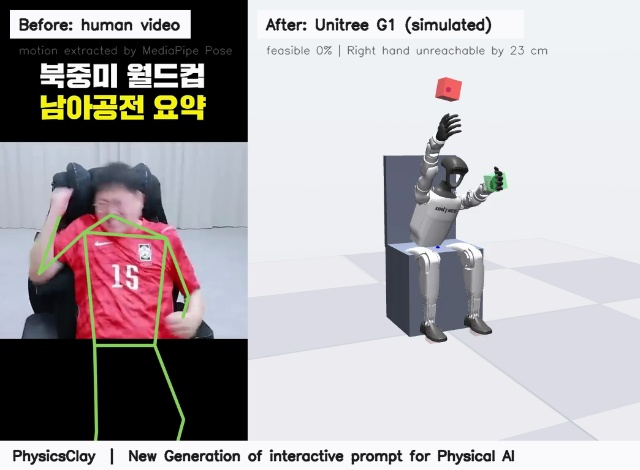
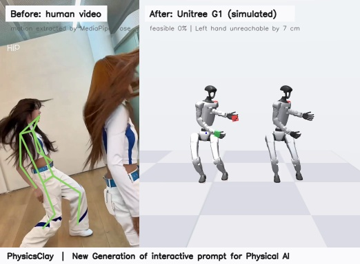
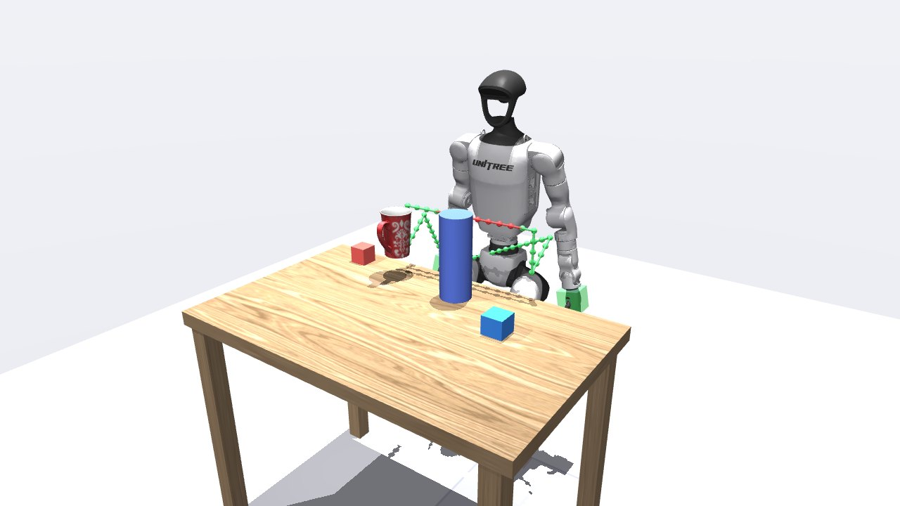
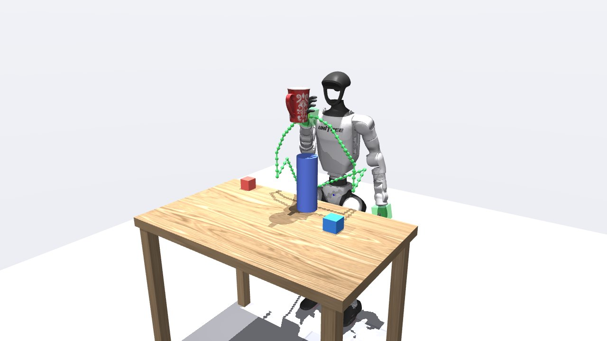
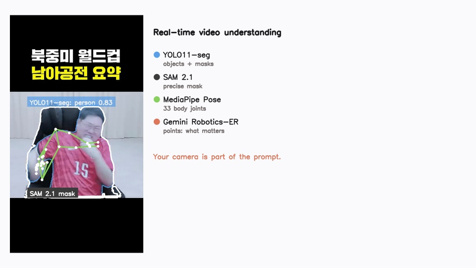
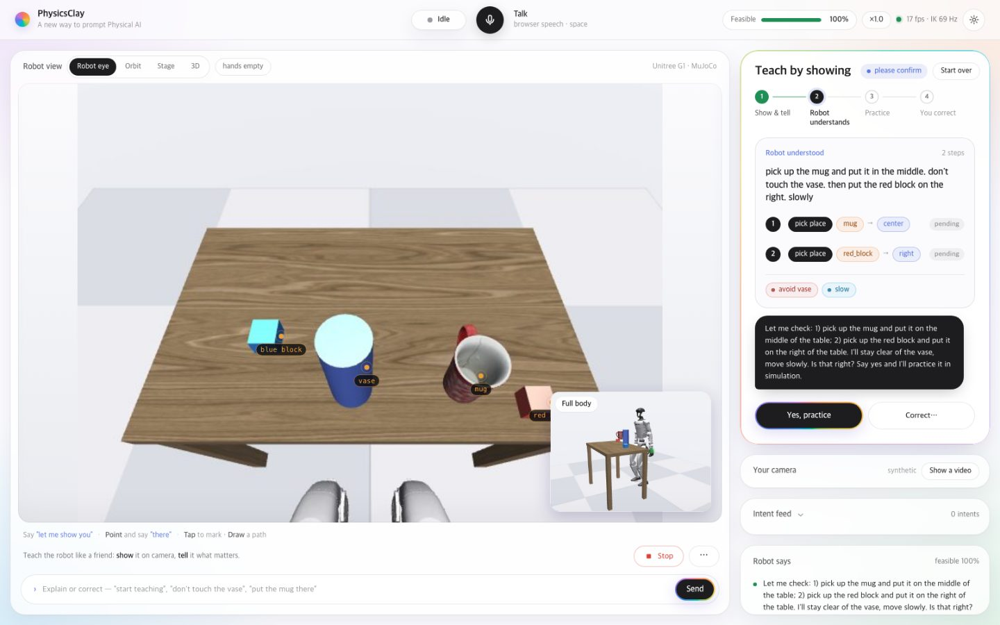

# PhysicsClay

### New Generation of interactive prompt for Physical AI
**Turning human intent into spatial instructions that robots can understand and execute.**

> Some tasks are nearly impossible to give a robot in text alone. You can't put everything you think into words —
> where exactly, which path, what not to touch — and some motions (a Taekwondo kick, a sprinter's stride, a dance)
> you can't describe at all. Showing beats describing. Physical AI needs its own prompt: a spatial one.

| | |
|---|---|
| **Demo video (2 min)** | [`docs/hackathon/demo/physicsclay_demo.mp4`](docs/hackathon/demo/physicsclay_demo.mp4) |
| **Live app** | https://physicsclay.jinminseong.com (phone camera + mic over HTTPS) |
| **Narrated pitch** | https://physicsclay.jinminseong.com/static/present.html |
| **Browser physics lab** | https://physicsclay.jinminseong.com/static/lab.html (MuJoCo WASM + React) |
| **Track** | YC RFS Fall 2026 · *New Operating System for the Physical World* |

## 3 key features

### ① Video → Robot action
Show a video; the robot learns the motion with its own body (arms, torso twist, squats, kicks), balance-checked, saved as a reusable skill.

| Seated: the robot sits like the person | Duet: two robots dance the same clip |
|---|---|
|  |  |

### ② Real-time trajectory lining + pointing, with real-time voice
Say what, draw where. A text-only command is refused by physics; a route drawn in 3D over the vase succeeds; point and say "there".

| Text only: refused (13 cm too low) | 3D route: carried over the vase |
|---|---|
|  |  |

### ③ Real-time video understanding
Your camera is part of the prompt: YOLO11 segmentation, SAM 2.1 masks, 33 MediaPipe pose joints, Gemini Live (voice + video)
and Gemini Robotics-ER (pointing). Teach the robot like a friend: show & tell → it asks back → practices in sim → you correct.

| Vision stack on a person's video | Teach by showing: the robot asks back |
|---|---|
|  |  |

## How it works
```
You: show (camera / video) · say (voice / text) · point & draw (robot view / 3D)
  -> intent: Gemini Live + Robotics-ER, YOLO11-seg, SAM 2.1, MediaPipe Pose      (understanding)
  -> spatial task spec: steps, targets, constraints ("avoid the vase", "slowly")   (the new prompt)
  -> physics: IK pre-check of every waypoint on a real Unitree G1 model, joint limits, collisions, balance
  -> refuse with a reason + a reachable alternative, or execute in MuJoCo; same spec compiles for a UR5e arm
```
Business: free browser playground (users) -> paid per robot for robot teams (humanoid makers, integrators, labs).
Roadmap: VR/XR teaching at true scale -> real robots -> learning from corrections across robots.

## Install
You need [uv](https://docs.astral.sh/uv/), git and curl, on macOS or Linux.
```bash
make setup                         # = ./scripts/setup.sh: .venv, deps (pyproject.toml), robot models, MediaPipe models
PC_EXTRAS=vision,data,dev ./scripts/setup.sh   # choose extras; `yolo` (Ultralytics, AGPL-3.0) is opt-in, see NOTICE
```

## Run
```bash
make run                           # http://127.0.0.1:8777 (synthetic person; add ARGS="--webcam" for your camera)
make run ARGS="--https --mock"     # + https://<lan-ip>:8443 so a phone can use its mic (accept the cert warning)
make run ARGS="--byok"             # public deployment: visitors bring their own API keys (see SECURITY.md)
./scripts/web.sh                   # the old launcher: same server on 8777, opens the browser
```
Open Settings in the page and paste a Gemini API key, which is stored only in the browser. You can also put server
keys in `.env`, which is never committed. Without a key, the page falls back to browser speech recognition and a
rule parser.
`web.sh` restarts only its own server (same `--port`), never others. YOLO segmentation is optional
(`uv pip install --python .venv/bin/python ultralytics`, AGPL-3.0); without it the camera overlay uses the
MediaPipe object detector.

## Test
```bash
make lint                          # ruff
make test                          # pytest unit suite (pure functions, a few seconds)
make selftest                      # end-to-end self test on an isolated server (PC_SELFTEST_OFFLINE=1 without keys)
```
Real camera, end to end (headless Chrome plays your own clip as its webcam; needs Chrome + ffmpeg, see
`scripts/e2e_camera.py` for how to record the clips):
`PC_CAM_POINT=point.mov PC_CAM_HAND=hand.mov PC_CAM_SQUAT=squats.mov .venv/bin/python scripts/e2e_camera.py`.

Contributing: [CONTRIBUTING.md](CONTRIBUTING.md) · Architecture: [docs/architecture.md](docs/architecture.md) ·
Security: [SECURITY.md](SECURITY.md)

## License
PhysicsClay is licensed under Apache-2.0 (see [LICENSE](LICENSE)). Third-party models, assets and libraries keep
their own licenses, which are listed in [NOTICE](NOTICE). The optional `yolo` extra (Ultralytics) is AGPL-3.0.

## Architecture
```
browser: Gemini Live (voice + your camera) --tool calls--> intents --WebSocket--> server
         Robotics-ER pointing on the robot view                                    |
server:  intent -> target (region / marker / raycast) -> hand path -> IK pre-check per waypoint
         -> refuse with a reason, or execute (kinematic grasp) -> verdict back to Gemini, which says it out loud
```
Protocol: `docs/PROTOCOL.md`. Assets: Unitree G1 (mujoco_menagerie), Google Scanned Objects mug (CC-BY 4.0).
Open source: MuJoCo, mink, MediaPipe, OpenCV, aiohttp; HUD patterns from CozyClay.

## Roadmap
1. Today: teach by showing (camera + voice + pointing + 3D routes) on a simulated Unitree G1 and a UR5e, physics-checked.
2. **VR / XR teaching**: stand inside the robot's space with a headset, grab the 3D route and the objects with your hands,
   and demonstrate at true scale; the same task spec and physics check carry over.
3. Real robots: send approved task specs to hardware (sim-checked first), learn from corrections across robots.
