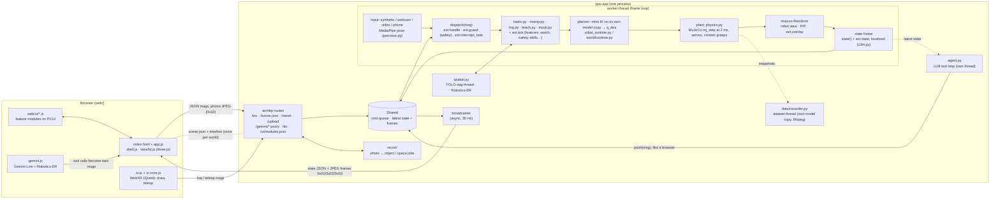
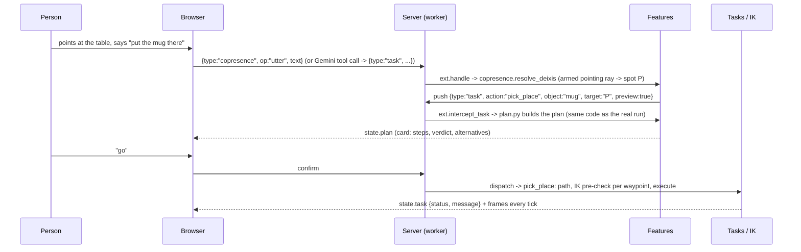

# Architecture

PhysicsClay is one Python process: an aiohttp server plus a simulation worker thread. A browser client connects to
it over a WebSocket. The person shows, says and points in the browser. The server grounds that intent in a MuJoCo
world, plans it with inverse kinematics (mink), checks it against the physics model and either runs it or explains why
it can't. The browser shows the result as video frames and a three.js scene.

This page describes the code as of v1.0.0. `docs/V1.md` is the contract for the v1 workstreams (dynamic physics,
datasets, trajectories and VR, watching the person, skills, safety, calibration, worlds, photo reconstruction) with an
"as built" section for each. The wire protocol is in `docs/PROTOCOL.md` and the world model is in `docs/WORLD.md`.

## Overview

## Server loop (`pps/app.py`)

* **`main()`** parses the flags (`--webcam`, `--video`, `--fake`, `--mock`, `--https`, `--byok`, `--kinematic`,
  `--port`…). It starts `run_server` in a daemon thread (the aiohttp app on HTTP, plus HTTPS with a self-signed cert
  from `certs/` when `--https` is set; `make run` sets it, on ports 8780 and 8781) and then runs **`worker()`** on the
  main thread.
* **`Shared`** is the only state the two threads share. It is guarded by a lock and holds the incoming command
  queue (`push_cmd` / `pop_cmds`), the latest state JSON and JPEG frames (`put` / `get`), the latest phone-camera
  JPEG, and the current scene payload.
* **`ws_handler`** turns each text message into `shared.push_cmd(json)`. A binary message starting with `0x10` is a
  phone-camera JPEG.
* **`broadcaster`** (async, 30 Hz) sends each new frame to every client: the state JSON, then binary frames tagged
  `0x01` (camera), `0x02` (robot view) and `0x03` (picture-in-picture).
* **`worker()`** builds the world (`pps.world.scene.build`), the runtime, `Tasks`, `Teacher`, `MockBrain`, `Demo`,
  `Spatial` and the feature context (`ext.make_ctx`). Then it loops once per frame:
  1. **Input**: read a frame from the synthetic dancer (`fake.py`), the webcam, a video or the phone, and run
     MediaPipe pose on it when a camera is on (`perceive.py`).
  2. **Commands**: pop every queued message and route it. Feature handlers (`ext.handle`) come first, then
     built-in types (`tap`, `draw`, `path3d`, `robot`, `world`, `teach`, `mock`, `demo`, `hello`, `settings`…). A
     `task` message goes through `ext.intercept_task` (safety's guard first, then for example plan preview, which
     takes `preview: true` tasks) and then to `dispatch()` → `Tasks`.
  3. **Step**: `rt.step(dt)` and `tasks.tick()` for a few IK iterations, then `teacher`, `demo` and
     `ext.run_ticks`, and finally the mock brain's narration. With physics on, `rt.step` is the planner and the plant
     then steps `n_sub = dt / 2 ms` substeps (capped on a busy machine; the planner's step is capped the same way, so
     plan and plant share one clock).
  4. **Render**: the robot-eye view or the orbit/stage camera, plus the picture-in-picture view, with the runtime's
     overlays and `ext.paint_overlays` (markers, zones, rays…), encoded as JPEG.
  5. **Publish**: `state()` plus world, robot, spatial, teach and demo state, plus `ext.extra_state(ctx)`. The
     people-facing sentences in it are rendered in the chosen language by `pps/i18n.py` (one global language, set by
     the browser's `hello` / `settings` message; PROTOCOL v17), and the frame is written with `shared.put()`.
* **HTTP routes**: `/` (the page), `/static/*` (`web/`), `/scene.json` and `/mesh/<id>.bin` (the current world's
  geometry for three.js), `/upload` (a video for whole-body imitation), `/gemini/live` and `/gemini/rest/*`
  (proxies that use the server's Gemini key, unless `--byok` is set), `/tts` (OpenAI TTS proxy), and
  `/ui/modules.json` (the list of `web/ui/*.js` modules).

## Feature extension system (`pps/ext.py`, `pps/features/`)

Features live in their own files instead of growing `app.py`. `ext.load()` imports every module in `pps/features/`
except names starting with `_`. Each module registers itself with decorators:

| Hook | Called | Use |
|---|---|---|
| `@ext.handler("type")` | for each browser message of that `type` | new message types (`zone`, `copresence`, `agent`…) |
| `@ext.pre_task` | for every `task` message, before the built-in dispatch; return `True` to consume it | plan preview, "which one?" candidates, deixis |
| `@ext.tick` | once per worker frame, after physics | timers, tracking, handovers |
| `@ext.state` | once per published frame; the returned dict is merged into the state | `zones`, `plan`, `copresence`, `agent`… |
| `@ext.overlay` | while rendering the robot view and the PiP (`fn(ctx, mjvScene)`) | drawing markers and rays into the MuJoCo render |

Every call goes through `_safe()`, so an exception in a feature is printed and never stops the robot loop. `ctx`
holds `rt`, `tasks`, `teacher`, `brain`, `demo`, `spatial`, `world`, the camera parameters of the last render, a
`store` dict for feature state, `push(msg)` to queue a message as if a browser had sent it, `dispatch(msg)` to run a
task message straight through the normal task path, and the latest pose landmarks (`lm`, `source`).

Shipped features: `plan` (propose, then confirm), `candidates` ("which one?"), `zones` (keep-out areas), `goal` (show
the end state), `timeline` (re-show one taught step), `gestures` (stop, slower, go on, come here), `point` (3D markers),
`copresence` (the person in the robot's world: pointing rays, deixis, handover, attention), `agent` (the LLM brain),
`watch` (mirror, learn, respond, assist, coach), `safety` (speed and separation, registered with `@ext.guard` so no
task is consumed before it is checked), `traj` (3D trajectories), `clearance` (the gripper check for trajectories),
`teleop` (live VR hand control), `skills` (skills from demonstration, packs), `dataset` (LeRobot recording), `calib`
(probes and calibration), `fixtures` (conveyors, locks, multi-step sequences) and `recon` (photos to objects and
spaces). A feature can also add task actions with `@ext.action` (`open`, `close`, `pick_from`, `place_in`, `sequence`).

## World and runtime (`pps/world/`, `pps/robot_runtime.py`)

* **Profiles** (`world/profiles.py`): every robot body PhysicsClay can drive. Each profile sets the model file, the
  mount, the end-effector sites by role, the home keyframe, the base kind and the capabilities. The prompts for each
  body are in `world/prompts/<id>.md` (LLM) and `<id>.json` (UI, copied to `web/robots/catalog.json`).
* **Scenes** (`world/scene.py`): a scene spec (`{template, objects: [...]}`) is normalised: kinds, colours and sizes
  are resolved and positions are clamped and spread. It is then written as MJCF (lights, floor, furniture,
  objects, IK target ghosts, the `robot_view` camera). The robot model is attached at its mount with `mujoco.MjSpec`,
  and the whole thing is compiled at once. Movable objects are `obj_<name>` and fixed ones `obs_<name>`.
* **Runtime**: `robot_runtime.Runtime` is the G1 (mirroring a person, whole-body retargeting, recording).
  `world/runtime.py` drives any other body through the same interface: end-effector `FrameTask`s by role, posture,
  limits, collision avoidance with the table, feet, centre of mass and root for legged bodies, and damped base
  joints for mobile bases. Both solve IK with `mink.solve_ik(..., "daqp")`.
* **Physics** (`physics.py`, v1 P0): `world/scene.py` compiles two models from one spec: the planner's
  (`world.ik_model`, objects as mocap) and the plant (`world.model`, objects as free bodies with mass and friction,
  real finger joints, built grippers where a model has none). The plant tracks `q_des` with position servos (gravity
  compensation, effort limits), and the task layer reads object poses, grasps (both jaws in contact), slip, weight and
  wrist force from it. `PC_PHYSICS=0` keeps the old kinematic mode (no plant).
* **Generated worlds** (`world/rooms.py`, `world/fixtures.py`, `world/objects.py`): seeded rooms with drawers, doors
  and conveyors (mocap parts in the planner, slide / hinge joints in the plant) and object kinds built from primitives;
  `manip.py` opens and closes them by their handles and runs `pick_from` / `place_in`. Demo packs are JSON in
  `world/packs/`.
* **Validation** (`validate.py`, `world/validate.py`): signals computed from the model, never from an LLM:
  unreachable (IK residual), joint limit, collision, too fast, and balance for legged bodies.
* **Tasks** (`tasks.py`): an intent (`pick_place`, `reach`, `follow_path`, skills…) is grounded to targets (a region,
  a marker, a ray hit or a drawn path) and compiled to a hand path. Every waypoint is pre-checked with IK. The
  task is then either refused with a reason and the nearest reachable alternative, or run. Each task reports
  itself in one sentence (`state.task`).
* **Teach by showing** (`teach.py`): a demonstration plus speech becomes a task spec (steps and constraints). The
  robot asks back, practises the spec in simulation and saves it as a skill. **Video imitation** (`/upload`,
  `retarget.py`, `body.py`) turns a person's motion into a whole-body G1 skill. **Cross-robot compile**
  (`compile_other.py`, `ir.py`) recompiles the same intent IR for another body.

## v1 packages

| Package | What it does | Guide |
|---|---|---|
| `pps/physics.py` | the plant: servos, grippers, contact grasps, slip, compliance, run-time parameters | `docs/V1.md` P0 |
| `pps/manip.py` | articulated fixtures: open / close by the handle, pick_from, place_in | `docs/worlds.md` |
| `pps/world/{fixtures,objects,rooms}.py` | generated homes and industrial sites | `docs/worlds.md` |
| `pps/traj.py` | the trajectory object: normalize, densify, check, keypoints, edits (pure numpy) | PROTOCOL v9 |
| `pps/human/` | the person in the world frame, activity, rules, coach, demos, VLM summary | PROTOCOL v6 |
| `pps/skills/` | skill kinds, extraction from demonstrations, compile to trajectories (pure numpy) | `docs/skills.md` |
| `pps/safety.py` | speed and separation monitoring and the contact policy (pure) | `docs/safety.md` |
| `pps/data/` | LeRobot v2.1 writer, dataset cameras, recorder thread, physics adapter | `docs/datasets.md` |
| `pps/calib/` | parameters, randomization, probes, logs, system identification | `docs/calibration.md` |
| `pps/bridge/` | the `RobotDriver` protocol, a sim driver, LeRobot / ROS 2 stubs | `docs/calibration.md` |
| `pps/recon/` | photo → object / space: recognition, segmentation, depth, scale, fitting, providers, library | `docs/RECON.md` |
| `pps/i18n.py` | the message catalog (English, Korean): `t(key)`, `tr(text)` | PROTOCOL v17 |
| `web/xr.js`, `web/xr-core.js` | WebXR session and the pure XR ↔ sim math and input pipeline | `docs/vr.md` |

## Agent and perception

* **Agent** (`agent.py`, wired by `features/agent.py`): an OpenAI-compatible Responses API tool loop running in its
  own thread. It only reads the latest published state and only acts by pushing browser-style messages, so it
  cannot do anything a client can't. Its tools come from the current robot's capabilities. Server keys come from
  `.env`. With `--byok`, the visitor's key comes with each message and is never stored. Prompts:
  `world/prompts/base.md` plus the body's prompt.
* **Mock brain** (`mock.py`): an offline stand-in that recognises gestures and narrates, so everything works without
  keys (`--mock`, and the self test).
* **Gemini** (`web/gemini.js`): Gemini Live (voice and video) and Robotics-ER pointing run from the browser, through
  the server proxy or with the visitor's key. Tool calls become ordinary task messages.
* **Spatial** (`spatial.py`): optional YOLO11 segmentation of the user's camera in a background thread
  (Ultralytics, AGPL-3.0, the `yolo` extra), or MediaPipe, plus Robotics-ER queries on demand.

## Web client (`web/`)

* `index.html` + `app.js`: the HUD. It handles the WebSocket and frames, the conversation, tapping and drawing on
  the robot view, settings and the Gemini wiring (`window.PC`).
* `shell.js`: the layout: the 3D stage with the robot-eye PiP, the plan header, the phone bottom sheet and the dock.
* `view3d.js`: the three.js scene, built from `/scene.json` and the mesh binaries, and moved each frame by
  `state.geom_poses`. It provides the 3D waypoint editor, table hits and layers for features (`window.PC3D`).
* `ui/core.js` (**PCUI**): the registry that front-end feature modules plug into. It provides `PCUI.state`,
  `onState`, `send`, `say`, `toast`, `slot(name)`, `tool({...})`, `with3D(fn)` and `icon`. Every other file in
  `web/ui/` is one feature (`plan.js`, `zones.js`, `copresence.js`, `robots.js`…) and is loaded from
  `/ui/modules.json`, so adding a feature never edits `index.html`.
* `xr.js` (WebXR on a Quest: VR and passthrough MR) draws into the 3D stage's scene; `xr-core.js` is its pure,
  unit-tested core. `phone.html` (`/phone`) is the light page that streams a phone's camera. `help-content.js` is the
  in-app guide (English / 한국어) shown by `ui/help.js`.
* `lab.html` (MuJoCo WASM + React) and `present.html` (the narrated pitch) are standalone pages.

## Data flow of one request

"Put the mug there" while pointing:

## Tests

* `tests/`: pytest unit tests for pure functions (scene normalisation, deixis and geometry, profiles, protocol, the ext
  registry, trajectories, skills, safety, calibration, teleop, path geometry, worlds, recon, the LeRobot writer, the
  message catalog and the docs' links). They need no server. `tests/*.mjs` test the browser's pure modules with
  `node --test`.
* `scripts/selftest.py`: starts an isolated server (`--fake --https`) and drives every feature over the real
  protocol. Then it runs each `scripts/checks/<feature>.py` (`async def run(t)`). `PC_SELFTEST_OFFLINE=1` skips the
  checks that need keys or the network. CI runs that mode headless on Linux. `PC_PHYSICS=0` runs it in kinematic mode,
  `PC_SELFTEST_CHECKS=a,b` runs only those checks.
* `scripts/e2e_ui.py` (headless Chrome over CDP: zoom, theme contrast, help, voice, camera, phone camera),
  `scripts/e2e_camera.py` (recorded clips as a fake webcam) and `scripts/bench_grasp.py` (contact pick & place per
  robot) are run by hand.
